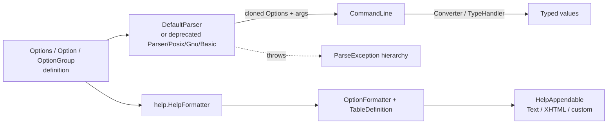

# Apache Commons CLI

## Overview

Apache Commons CLI (`commons-cli` 1.12.0-SNAPSHOT) is a Java library that provides an API for defining, parsing, validating, and documenting command-line interfaces. It is a pure library (no server, no application entry point) built with Maven from a single module (`pom.xml`), targeting Java 8 (`maven.compiler.source/target = 1.8`) and producing the JPMS/OSGi name `org.apache.commons.cli`. The production code lives in two packages under `src/main/java/org/apache/commons/cli/`: the core API (`Options`, `Option`, parsers, `CommandLine`) and the help-production subsystem (`cli/help`, added in 1.10.0). The library has **no runtime dependencies** — every dependency in `pom.xml` (JUnit 5, Mockito, commons-io, commons-text) is test-scoped.

## Components

### Option definition model
- **Purpose** — Describes what a command line may contain: individual options (short/long name, argument arity, defaults, value separators, converters, deprecation metadata), mutually exclusive groups, and the aggregate registry used for lookup.
- **Key source locations**:
  - `src/main/java/org/apache/commons/cli/Option.java` (immutable-ish value type with a `Builder`, `processValue()`, `UNLIMITED_VALUES`)
  - `src/main/java/org/apache/commons/cli/Options.java` (registry: `shortOpts`, `longOpts`, `optionGroups`, `requiredOpts` maps)
  - `src/main/java/org/apache/commons/cli/OptionGroup.java` (`setSelected()` throws `AlreadySelectedException`)
  - `src/main/java/org/apache/commons/cli/DeprecatedAttributes.java`, `OptionValidator.java`, `OptionBuilder.java` (deprecated static builder)
- **Interactions** — `Options.addOption()` indexes each `Option` by short key and long name; parsers look options up through `Options.getOption()/hasOption()` and `getMatchingOptions()`, clone them, and add the clones to `CommandLine`. The help subsystem reads the same `Options`/`Option` objects (descriptions, `since`, required flags) to render usage tables.

### Parsing layer
- **Purpose** — Turns a `String[]` of raw arguments plus an `Options` descriptor into a populated `CommandLine`, enforcing required options, option groups, and argument-count rules.
- **Key source locations**:
  - `src/main/java/org/apache/commons/cli/CommandLineParser.java` (the `parse(Options, String[])` contract)
  - `src/main/java/org/apache/commons/cli/DefaultParser.java` (current single-pass parser, since 1.3; nested `Builder`, `NonOptionAction` enum)
  - `src/main/java/org/apache/commons/cli/Parser.java` (deprecated abstract two-pass "flatten" parser) with `BasicParser`, `PosixParser`, `GnuParser` subclasses
  - `src/main/java/org/apache/commons/cli/ParseException.java` and subclasses `MissingOptionException`, `MissingArgumentException`, `UnrecognizedOptionException`, `AmbiguousOptionException`, `AlreadySelectedException`
- **Interactions** — `DefaultParser` reads `Options`, clones matched `Option`s into the `CommandLine` it builds (`handleOption()`), invokes `Option.processValue()` for argument tokens, tracks group selection via `Options.getOptionGroup()`, and resolves the option-prefix constants from `help/OptionFormatter` (`"-"`, `"--"`). It reuses `Util.stripLeadingHyphens()`/`stripLeadingAndTrailingQuotes()`. The deprecated `Parser` hierarchy implements the same contract but pre-flattens tokens via the abstract `flatten()` method before processing.

### Result model (`CommandLine`)
- **Purpose** — Holds the parsed options and leftover positional arguments and exposes query APIs: `hasOption`, `getOptionValue(s)`, `getParsedOptionValue(s)` (typed), `getOptionProperties`, `getArgList`.
- **Key source locations**:
  - `src/main/java/org/apache/commons/cli/CommandLine.java` (nested `Builder`, `resolveOption()`, ~50 `getOptionValue`/`getParsedOptionValue` overloads)
- **Interactions** — Built by both parser families through `CommandLine.builder()`; resolves names back to `Option` instances with `Util.stripLeadingHyphens`; converts string values with `Option.getConverter()` (falling back to `TypeHandler.getDefault()`); invokes the injected `deprecatedHandler` (`Consumer<Option>`, default prints to `System.out`) when a deprecated option is queried.

### Type conversion
- **Purpose** — Converts raw option value strings into typed objects (`File`, `URL`, `Date`, `Number`, `Class`, …).
- **Key source locations**:
  - `src/main/java/org/apache/commons/cli/Converter.java` (functional interface, `DEFAULT` identity converter)
  - `src/main/java/org/apache/commons/cli/TypeHandler.java` (`createDefaultMap()`, singleton `getDefault()`)
  - `src/main/java/org/apache/commons/cli/PatternOptionBuilder.java` (legacy pattern codes → classes/converter lookup)
- **Interactions** — Selected per-option via `Option.Builder.converter(...)` or by `Option.type`; consumed by `CommandLine.getParsedOptionValue*()` and by `OptionBuilder.withType()`. Several `TypeHandler` static factory methods are deprecated in favor of converters.

### Help production subsystem (`org.apache.commons.cli.help`, since 1.10.0)
- **Purpose** — Renders usage/help output through a pluggable pipeline: a formatter decides *what* to show, an `OptionFormatter` decides *how each option is spelled*, a `TableDefinition` describes the layout, and a `HelpAppendable` decides the *output format* (plain text, XHTML, …).
- **Key source locations**:
  - `src/main/java/org/apache/commons/cli/help/AbstractHelpFormatter.java` (framework: `printHelp()`, `toSyntaxOptions()`, abstract `getTableDefinition()`, self-typed `Builder`)
  - `src/main/java/org/apache/commons/cli/help/HelpFormatter.java` (default implementation, 2- or 3-column table with optional "Since" column)
  - `src/main/java/org/apache/commons/cli/help/OptionFormatter.java`, `TableDefinition.java`, `TextStyle.java`
  - `src/main/java/org/apache/commons/cli/help/HelpAppendable.java`, `TextHelpAppendable.java` (word-wrapping text renderer), `FilterHelpAppendable.java` (decorator base)
- **Interactions** — `HelpFormatter.printHelp()` writes the syntax line (via `toSyntaxOptions(Options)`, which honors `OptionGroup`s) then `helpAppendable.appendTable(getTableDefinition(options.getOptions()))`. It depends on the core model (`Options`, `Option`, `OptionGroup`) but nothing in the core model depends on it. Test sources show custom renderers (`src/test/java/org/apache/commons/cli/example/XhtmlHelpAppendable.java`, `AptHelpAppendable.java`). The legacy `src/main/java/org/apache/commons/cli/HelpFormatter.java` is deprecated and renders independently through a `PrintWriter` without using this subsystem.

## Data / Control Flow

Representative parse flow with `DefaultParser`:

1. The application builds an `Options` descriptor (`Options.addOption(...)` indexes each `Option` into `shortOpts`/`longOpts`; `addOptionGroup` registers groups and clears member `required` flags).
2. `DefaultParser.parse(options, properties, nonOptionAction, arguments...)` resets parser state, clears group selections, copies `options.getRequiredOptions()` into `expectedOpts`, and creates a `CommandLine` via `CommandLine.builder()`.
3. Each token goes through `handleToken()`:
   - `--` sets `skipParsing` (all remaining tokens become arguments);
   - if the current option accepts an argument and the token is not an option (or is a negative number), it is consumed via `currentOption.processValue(...)` (quote stripping applied);
   - `--long` / `-long` forms route to `handleLongOption*()` (partial matching may yield `AmbiguousOptionException`; `--name=value` splits at `=`);
   - `-x` forms route to `handleShortAndLongOption()` (single short, concatenated `-abc`, Java-style `-Dkey=value`, long-prefix `-Xmx512m`, or `-S=V`);
   - anything else hits `handleUnknownToken()`, which applies the `NonOptionAction` (IGNORE/SKIP/STOP/THROW).
4. `handleOption()` clones the matched `Option`, records it on the `CommandLine`, updates group selection, and removes satisfied required entries from `expectedOpts`.
5. After all tokens: `checkRequiredArgs()` → `handleProperties(properties)` (default values for absent options) → `checkRequiredOptions()` throws `MissingOptionException` if unmet.
6. The application queries the returned `CommandLine` (`hasOption`, `getOptionValue`, `getParsedOptionValue` → `Option.getConverter()`), and may call a `HelpFormatter.printHelp(...)` to print usage.

## Key Decisions & Gotchas

1. **Stateful, non-thread-safe parsers that clone options.** `DefaultParser` mutates instance fields (`cmd`, `currentOption`, `skipParsing`, `expectedOpts`) during `parse()`, and both parser families clone each matched `Option` before adding it to `CommandLine`, while clearing prior values/group selections at the start of every parse (comment referencing CLI-71 in `Parser.java:152`). One parser instance must not be used concurrently.
2. **Heterogeneous "required" lists.** `Options.requiredOpts` and `DefaultParser.expectedOpts` are `List<Object>` holding both `String` option keys and `OptionGroup` objects — flagged by the authors with `// TODO this seems wrong` (`Options.java:54`, `DefaultParser.java:225`).
3. **Tri-state quote stripping.** `DefaultParser.Builder.stripLeadingAndTrailingQuotes` is a `Boolean`: `true` always strips balanced outer quotes, `false` never does, and `null` (the default, historic behavior) strips only for space-separated values (`stripLeadingAndTrailingQuotesDefaultOn/Off`).
4. **Non-option handling is an enum, not just a flag.** `NonOptionAction` (IGNORE/SKIP/STOP/THROW, since 1.10.0) generalizes the older boolean `stopAtNonOption`, whose deprecated field is retained in `DefaultParser` purely for binary compatibility.
5. **Long-option partial matching is on by default.** `Options.getMatchingOptions()` does prefix matching; multiple candidates without an exact match raise `AmbiguousOptionException` unless built with `setAllowPartialMatching(false)`.
6. **Extensive deprecated surface kept for compatibility.** `Parser` + `BasicParser`/`PosixParser`/`GnuParser` (two-pass flatten), the static mutable `OptionBuilder` (explicitly documented as NOT thread safe), the root `HelpFormatter`, and `build()` methods on all builders (replaced by `Supplier.get()`) are deprecated; the build's default goal runs `japicmp:cmp` against `commons.bc.version = 1.11.0` to enforce API compatibility.
7. **Deprecation is surfaced at query time.** `CommandLine.hasOption(Option)` calls the transient `Consumer<Option> deprecatedHandler` (default: print `Option.toDeprecatedString()` to `System.out`) whenever a deprecated option is checked; the field is `transient`, with an in-code warning to use a serialization proxy if serialization matters.
8. **Quality gates are part of the architecture contract.** The `pom.xml` sets JaCoCo halt-on-failure thresholds (98% instruction/line, 95% branch) and wires Checkstyle, SpotBugs, PMD, RAT, and Javadoc into the default Maven goal.
