# OpenTelemetry Collector

## Overview

The OpenTelemetry Collector is a Go-based telemetry data pipeline framework for receiving, processing, and exporting traces, metrics, logs, and profiles. It is a multi-module Go monorepo (`go.mod` at root notes it is "NOT used to build any official binary"; binaries are assembled from per-module sets declared in `versions.yaml`, with `stable: v1.68.0` and `beta: v0.162.0` release tracks). The project is primarily a library (`component/`, `service/`, `otelcol/`) from which distributable binaries are generated by a builder tool (`cmd/builder`), with the local test binary checked in at `cmd/otelcorecol/`.

## Components

### Component model — `component/`, signal packages, `consumer/`, `pipeline/`

- **Purpose** — Defines the contracts every plugin implements: lifecycle (`component.Component` with `Start`/`Shutdown`), identity (`component.Type`, `component.ID` as `type[/name]`), configuration (`component.Config = any`), factories (`component.Factory` with `Type()` + `CreateDefaultConfig()`), and stability levels (`component.StabilityLevel`, seven levels from `Undefined` to `Stable` in `component/component.go:103`). The signal packages (`receiver/`, `processor/`, `exporter/`, `connector/`, `extension/`, `scraper/`) turn these into typed per-signal interfaces and sealed factories.
- **Key source locations** — `component/component.go`, `component/identifiable.go`, `component/componentstatus/status.go`, `receiver/receiver.go`, `processor/processor.go`, `exporter/exporter.go`, `connector/connector.go`, `consumer/consumer.go`, `pipeline/pipeline.go`
- **Interactions** — Receivers are *not* consumers; their factory (`CreateTraces(ctx, set, cfg, next consumer.Traces)`) is handed the downstream consumer by the graph builder, while processors/exporters/connectors embed `consumer.X` themselves. The service layer consumes these interfaces through `service/internal/builders` (factory + config lookup) and `componentstatus.Reporter`/`Watcher` for lifecycle events. `x`-suffixed packages (`xreceiver`, `xconnector`, `xconsumer`, `xpipeline`, …) extend the stable packages with experimental profiles support; builders detect them via type assertion. Factories are passed as maps (`otelcol.Factories`), never a global registry, and `internal/componentalias` lets a factory register a deprecated type alias.

### Collector runtime and CLI — `otelcol/`

- **Purpose** — Owns the process lifecycle: flag parsing, config resolution, service construction, the signal/reload control loop, and shutdown. Exposes both a `Collector` API and a cobra `Command` for binaries.
- **Key source locations** — `otelcol/collector.go` (lifecycle: `New` → `Run` → `shutdown`), `otelcol/command.go` + `otelcol/flags.go` (`--config`, `--set`, `--feature-gates`, subcommands `validate`, `print-config`, `components`, `featuregate`), `otelcol/configprovider.go`, `otelcol/unmarshaler.go`, `otelcol/config.go`, `otelcol/factories.go`, `otelcol/redact.go`, `otelcol/config_diff.go`
- **Interactions** — Wraps `confmap.Resolver` (via `ConfigProvider`) to load configuration, decodes it into `otelcol.Config` using per-component factories, validates it (`confmap.Validate` + `otelcol.Config.Validate`), then constructs and starts a `service.Service`. The `Run` loop `select`s on config watch, async error channel, OS signals (`SIGHUP` triggers reload, including a gated partial receiver-only reload via fingerprinting in `config_diff.go`), shutdown channel, and context. Fatal component errors arrive through the unbuffered async error channel. Bootstrap logging uses a swappable zap core (`buffered_core.go`/`collector_core.go`) so early logs survive until the service logger exists.

### Service and pipeline graph — `service/`

- **Purpose** — Builds and runs the actual dataflow DAG from pipeline configuration, manages extensions, and provides the collector's own telemetry (self-observability) and component status reporting.
- **Key source locations** — `service/service.go` (construction/start/shutdown ordering), `service/internal/graph/graph.go` (node/edge creation, topological start/shutdown, `UpdateReceivers` hot reload), `service/internal/graph/host.go` (`graph.Host` implementing `component.Host`), `service/extensions/extensions.go`, `service/internal/status/status.go` (status FSM), `service/telemetry/telemetry.go` + `service/telemetry/otelconftelemetry/` (default telemetry factory), `service/internal/obsconsumer/`, `service/internal/refconsumer/`
- **Interactions** — `service.New` asks the `telemetry.Factory` for a shared resource, logger, meter provider, and tracer provider, then builds the graph. `graph.Build` creates per-pipeline nodes — receivers → `capabilitiesNode` → processors → `fanOutNode` → exporters — using gonum `topo.Sort` for ordering; receiver/exporter nodes are deduplicated and shared across pipelines of the same signal, processors never are. Connectors become `connector.New*Router` fan-in points. Data passing through the graph is wrapped by `obsconsumer` (item/size counters), `refconsumer` (pipeline ownership refcounting into `pdata/xpdata/pref`), `capabilityconsumer` (aggregated `MutatesData`), and `internal/fanoutconsumer` (clone-vs-share fan-out). Component status flows through a per-instance FSM (`service/internal/status`) into `Host.NotifyComponentStatusChange`, which fans out to watcher extensions and pushes fatal errors into the collector's async error channel. Extensions are started in dependency order (`extensioncapabilities.Dependent`) and shut down in reverse.

### Configuration system — `confmap/`, `config/`, `featuregate/`

- **Purpose** — Resolves multi-source configuration (URIs, providers, `${...}` expansion, converters), performs strict decoding into component configs, supplies reusable config building blocks for transports/security, and gates experimental behavior.
- **Key source locations** — `confmap/resolver.go` (URI retrieve → merge → expand → convert), `confmap/expand.go` (expansion rules), `confmap/internal/decoder.go` (mapstructure decoding), `confmap/validation.go`, `confmap/provider/{env,file,yaml,http,https}provider/`, `config/confighttp/`, `config/configgrpc/`, `config/configtls/`, `config/configopaque/`, `config/configoptional/`, `config/configauth/`, `featuregate/registry.go`
- **Interactions** — `otelcol` flags feed `ResolverSettings`: `--config` URIs in order, then `--set` entries rewritten as `yaml:` URIs so they merge last (highest precedence), with `DefaultScheme = "env"`. Each provider returns a `Retrieved` that is YAML-parsed and merged (last wins); expansion of `${scheme:value}` happens recursively (cap 1000) before converters run. Decoding layers user YAML over `factory.CreateDefaultConfig()` per component ID and rejects unknown keys by default. Transport configs compose: `confighttp`/`configgrpc` embed `configtls`, `configoptional.Optional[configauth.Config]` (auth resolves extensions from the host), `configcompression`, `configretry`, `configmiddleware`. Feature gates are registered on `featuregate.GlobalRegistry()` (stable gates cannot be disabled; deprecated cannot be enabled) and surfaced via `--feature-gates` and the `featuregate` subcommand.

### Data representation — `pdata/`

- **Purpose** — Zero-copy, mutable in-memory representation of OTLP telemetry (traces, metrics, logs, profiles) used by every pipeline stage, with proto and JSON codecs.
- **Key source locations** — `pdata/pcommon/`, `pdata/plog/`, `pdata/pmetric/`, `pdata/ptrace/`, `pdata/pprofile/`, `pdata/internal/` (generated message structs, wire codecs, `state.go` refcounting), `pdata/xpdata/` (experimental: `pref` refcounting, `request` persistable request+context envelope), `internal/cmd/pdatagen/main.go` (generator)
- **Interactions** — Generated by the in-repo `pdatagen` tool (`make genpdata`), not `protoc`; the OTLP schema is declared in Go under `internal/cmd/pdatagen/internal/pdata/`, and wire compatibility with real OTLP protos is asserted in tests against `go.opentelemetry.io/proto/slim/otlp`. Public types (e.g. `plog.Logs`) are wrappers over generated structs that implement `MarshalProto`/`UnmarshalProto`/`MarshalJSON`. Ownership is enforced by `pdata/internal/state.go`: atomic refcounts plus read-only/pipeline-owned bits cause `AssertMutable()` to panic on shared-data misuse. `fanoutconsumer` marks data read-only before sharing it across multiple consumers; `batchprocessor` and the exporter queue hold references across goroutines via `xpdata/pref.Ref*/Unref*`.

### Component helpers and built-in components — `exporterhelper/`, `processorhelper/`, `scraperhelper/`, `processor/`, `receiver/`, `extension/`

- **Purpose** — Shared machinery that component authors compose rather than reimplement: exporter send pipelines (timeout → retry → observability → queue/batch), processor wrappers, scraper-driven receivers, plus the core components shipped in-tree (OTLP receiver/exporters, batch, memory limiter, queue-batch, forward connector, debug exporter, zpages).
- **Key source locations** — `exporter/exporterhelper/internal/base_exporter.go` (sender chain), `exporter/exporterhelper/internal/queuebatch/` (batcher + partitioner), `exporter/exporterhelper/internal/queue/` (memory + persistent queue), `exporter/exporterhelper/internal/retry_sender.go`, `processor/processorhelper/processor.go`, `processor/batchprocessor/batch_processor.go`, `processor/memorylimiterprocessor/`, `internal/memorylimiter/memorylimiter.go`, `scraper/scraperhelper/internal/controller/controller.go`, `receiver/otlpreceiver/`, `extension/zpagesextension/`
- **Interactions** — `NewBaseExporter` chains senders in a fixed order: queue → observability → retry → timeout → the pusher. Enabling batching forces `MutatesData: true`; setting `storage:` swaps the in-memory queue for a persistent queue that resolves a `storage.Extension` from `host.GetExtensions()`. Shutdown order is retry sender first, then queue (so queued items flush without retries). `processor/queuebatchprocessor` reuses the exporter queue/batch machinery for processors. The memory limiter shares one engine across processor instances with identical config (factory-level map + mutex) and refuses data via `ErrDataRefused` without mutating it. `scraperhelper` wraps `scraper.Metrics/Logs` scrapers in a ticker-driven controller and exposes them as a `receiver.*`. The OTLP receiver shares one gRPC/HTTP server across signal instances via `internal/sharedcomponent`.

### Build, distribution, and code generation — `cmd/`, `internal/cmd/`, `Makefile`

- **Purpose** — Generates collector binaries from a manifest, generates per-component metadata/telemetry/config code from `metadata.yaml`, generates the pdata layer, and produces JSON schemas.
- **Key source locations** — `cmd/builder/internal/builder/` (`ocb`: templates for `main.go`/`components.go`/`go.mod`, `go mod tidy` + strict otelcol version check), `cmd/mdatagen/` (`generated_status.go`, `generated_telemetry.go`, `generated_config.go`, stability coverage checks via `.mdatagen.yaml`), `cmd/schemagen/`, `internal/cmd/pdatagen/`, `cmd/otelcorecol/{main.go,components.go}` (generated by `make genotelcorecol` from `builder-config.yaml`), root `Makefile`
- **Interactions** — Component packages declare stability, config schema, metrics, and feature gates in `metadata.yaml`; `mdatagen` emits the `TelemetryBuilder`s consumed by helper packages and the `*Stability` constants wired into factories (`WithTraces(create, metadata.TracesStability)`). `ocb` renders a distribution `main.go` and `components()` that call `otelcol.MakeFactoryMap`, then runs `go mod tidy` and (unless `--skip-strict-versioning`) verifies the otelcol dependency matches the pinned beta version. Root `Makefile` orchestrates per-module targets (`gogenerate`, `genpdata`, `check-stability`, `apidiff`, lint/test) across all modules.

## Data / Control Flow

Startup and configuration loading:

1. A binary (e.g. `cmd/otelcorecol/main.go`) builds `otelcol.CollectorSettings` with factories, config providers, and build info, then runs `otelcol.NewCommand(...).Execute()`.
2. `otelcol` parses flags: `--config` URIs plus `--set` overrides (appended as `yaml:` URIs, so they win on merge), `--feature-gates`.
3. `ConfigProvider.getWithConf` → `confmap.Resolver.Resolve`: each URI is retrieved by its provider, merged (last wins), snapshotted pre-expansion, `${...}` variables expanded, converters applied.
4. `unmarshal` decodes into `otelcol.Config`: for every component ID, `factory.CreateDefaultConfig()` is overlaid with the user's sub-config (unknown keys error). Then `confmap.Validate` + `Config.Validate` check references (pipelines → components, extensions, connector ambiguity).
5. `service.New` creates self-telemetry (resource → logger → meter → tracer), then `graph.Build` constructs and wires the pipeline DAG, then extensions are created and ordered by dependencies.
6. `service.Start`: extensions start → config-snapshot notification → pipelines start (topological, downstream-first) → `PipelineWatcher.Ready` notifications.

```mermaid
flowchart LR
    subgraph Config
        URI["--config / --set URIs"] --> P["Providers (file/env/yaml/http)"]
        P --> R["confmap.Resolver<br/>merge → expand → convert"]
        R --> U["otelcol.unmarshal<br/>factory defaults + user config"]
        U --> V["Validate"]
    end
    V --> S["service.New → graph.Build"]

    subgraph Pipeline["service/internal/graph (per pipeline)"]
        RCVR["receiver node<br/>(shared per signal)"] --> CAP["capabilitiesNode<br/>(MutatesData)"]
        CAP --> P1["processor₁"] --> PN["processorₙ"] --> FAN["fanOutNode"]
        FAN --> EXP["exporter nodes"]
    end
    S --> RCVR
    CONN["connector node<br/>(router fan-in)"] --> FAN
    EXP -.->|feeds downstream pipeline| CONN
```

Steady-state data flow for one signal: the receiver calls `next.ConsumeTraces(ctx, td)` → `obsconsumer` counts items → processors run in order → `fanOutNode` fans out via `fanoutconsumer` (cloning for mutating consumers, `MarkReadOnly()` for multiple read-only consumers) → each exporter's `BaseExporter.Send` walks queue → obs → retry → timeout → push. Errors are accumulated with `multierr.Append` and returned upstream; `consumererror` classifies retryable/permanent/downstream failures. Control flow: fatal component status events travel FSM → `Host.NotifyComponentStatusChange` → async error channel → `Collector.Run` breaks its select loop → graceful shutdown (pipelines → extensions → telemetry providers, reverse creation order, errors joined not short-circuited).

## Key Decisions & Gotchas

1. **Multi-module monorepo with no single `go.mod`** — every package is its own module with independent stability (`versions.yaml` stable v1.68.0 vs beta v0.162.0); the root module explicitly does not build any binary. `Makefile.Common` drives per-module lint/test/generate, and `cmd/builder` enforces otelcol version compatibility when generating distributions.
2. **Fan-out clones based on `MutatesData` capabilities** — `internal/fanoutconsumer` never shares mutable data with a read-only consumer: it clones for all but the last mutating consumer, marks data read-only when feeding multiple read-only consumers, and short-circuits a single non-mutating consumer. Capabilities are aggregated up the pipeline (`capabilitiesNode`, `aggregateCap` for connectors), and processorhelper defaults to `MutatesData: true` while exporterhelper defaults to `false`.
3. **Configuration is strict, layered, and last-wins** — unknown keys are errors by default (case-sensitive, no weak typing); per-component configs are factory defaults overlaid with user config; `--set` beats `--config` because it merges later; `$$` escapes `${...}` expansion; `configopaque.String` always marshals as `[REDACTED]`, which is what powers `print-config` redaction and the pre-expansion snapshot (`redactByMirroring` deliberately leaves bare `${...}` references visible).
4. **Startup fails fast, shutdown accumulates** — the first component start failure aborts and triggers cleanup, but every shutdown path (`Collector.shutdown`, `Service.Shutdown`, `Graph.ShutdownAll`, extensions, fan-out) collects all errors with `multierr`/`errors.Join` and continues. Fatal component errors are formalized as status events flowing through a per-instance state machine, not ad-hoc channel sends; recoverable errors (e.g. memory-limiter refusals) never terminate the process.
5. **Reload can be partial** — `SIGHUP`/watch-triggered reloads hash the raw config (`config_diff.go`, FNV over `json.Marshal`) and, when only receiver configs changed (both `service.partialReload` and `service.partialReloadReceivers` gates), `graph.UpdateReceivers` swaps only affected receiver nodes in nine phases (shutdown → rewire → build → start), leaving processors/exporters/connectors untouched; any mid-way failure falls back to a full restart.
6. **Code generation is central to the component contract** — pdata is generated by an in-repo `pdatagen` (proto schema declared in Go, wire-tested against real OTLP protos), while `mdatagen` turns each component's `metadata.yaml` into stability constants, `TelemetryBuilder`s, config structs, and JSON schemas, with test-coverage thresholds per stability level (`.mdatagen.yaml`: stable requires 80%).
7. **Queues are shared infrastructure** — the exporter queue/batch implementation (`queuebatch` + `queue`) supports memory and storage-backed persistence, metadata-based partitioning (LRU of partition batchers), and N consumer goroutines; `processor/queuebatchprocessor` reuses it verbatim, so batching forces `MutatesData: true` and a forced `NumConsumers = 1` when batching without a partitioner (per in-code comment referencing issue #12473).
