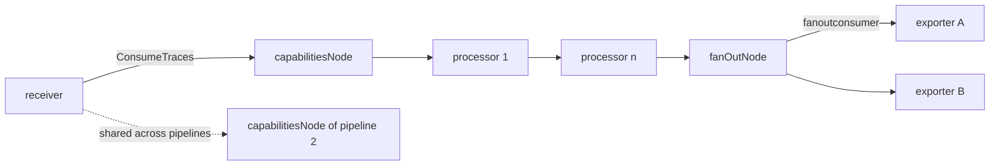
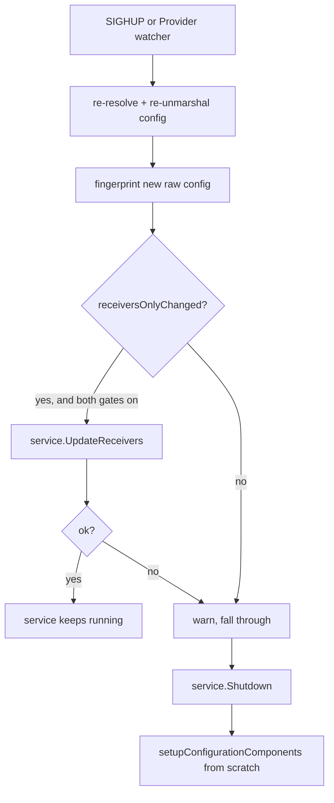

# OpenTelemetry Collector (core)

## Overview

The OpenTelemetry Collector core is a telemetry-agnostic routing proxy written in Go. It reads a
declarative configuration, builds a directed acyclic graph of *components* (receivers,
processors, exporters, connectors, extensions), and pushes telemetry received on one signal
(traces / metrics / logs, plus an experimental profiles signal) through that graph. The
repository is a **Go multi-module monorepo** — 99 separate `go.mod` modules under the single
`go.opentelemetry.io/collector` module path, with no `go.work` file. Coordination between modules
is done entirely through `replace` directives and Make recursion (`Makefile:152-163` fans a
target out to every module directory). It is primarily a **framework/library plus a reference
server binary** (`cmd/otelcorecol`): the actual production distributions are assembled by the
`cmd/builder` tool from a manifest.

## Components

### Entry point and CLI — `cmd/otelcorecol`, `otelcol/command.go`

- **Purpose** — The reference binary and the cobra command tree (`otelcorecol`, `featuregate`,
  `components`, `validate`, `print`). It exists mainly to exercise the framework locally; it is
  explicitly labelled "testing only" in its own `BuildInfo`.
- **Key source locations** — `cmd/otelcorecol/main.go`, `cmd/otelcorecol/components.go`,
  `otelcol/command.go`, `otelcol/flags.go`, `otelcol/command_print.go`,
  `otelcol/command_components.go`, `otelcol/command_validate.go`.
- **Interactions** — `main.go` constructs an `otelcol.CollectorSettings` (build info, a
  `components()` factory func returning `otelcol.Factories`, and a `confmap.ResolverSettings`
  listing five provider factories) and hands it to `otelcol.NewCommand`. `NewCommand`'s `RunE`
  applies CLI flags, calls `otelcol.NewCollector`, then `col.Run(ctx)`.
- **Note** — `cmd/otelcorecol/main.go` and `components.go` carry the header
  `// Code generated by "go.opentelemetry.io/collector/cmd/builder". DO NOT EDIT.` They are
  produced from `cmd/otelcorecol/builder-config.yaml` by the `genotelcorecol` Make target.

### Collector lifecycle and control loop — `otelcol/collector.go`

- **Purpose** — Owns the process-level state machine, the log buffer used before a real logger
  exists, OS signal handling, config-reload policy, and shutdown sequencing.
- **Key source locations** — `otelcol/collector.go` (`State`, `CollectorSettings`, `Collector`),
  `otelcol/configprovider.go`, `otelcol/config_diff.go`, `otelcol/redact.go`,
  `otelcol/buffered_core.go`.
- **Interactions** — Calls `ConfigProvider.Get`/`getWithConf` for config, `service.New` +
  `service.Start` / `service.Shutdown` for the runtime, `grpclog.SetLogger`, and selects over
  four channels in its control loop (`otelcol/collector.go:461-491`): the config watcher, the
  component async-error channel, the OS signal channel, and the shutdown channel.

### Configuration resolution — `confmap/`

- **Purpose** — Loads, merges, and expands raw configuration from pluggable URI-scheme
  providers into a single `confmap.Conf`, resolving `${scheme:key}` references.
- **Key source locations** — `confmap/resolver.go` (`Resolver`, `Resolve`, `Watch`),
  `confmap/expand.go` (`${}` expansion), `confmap/internal/conf.go` (`Conf`),
  `confmap/internal/decoder.go` (mapstructure hooks), `confmap/validation.go`,
  `confmap/provider.go`, `confmap/provider/{env,file,http,https,yaml}provider/`.
- **Interactions** — `Resolver.Resolve` calls `Provider.Retrieve` per configured URI, merges the
  results, snapshots a pre-expansion copy, expands values, then runs any `Converter`s. Built on
  `github.com/knadh/koanf/v2` with `"::"` as the key delimiter.

### Configuration typing and validation — `otelcol/unmarshaler.go`, `config/`

- **Purpose** — Turns the untyped `Conf` into typed `component.Config` values by dispatching to
  each component's factory, then validates the result.
- **Key source locations** — `otelcol/config.go` (top-level `Config`), `otelcol/unmarshaler.go`
  (`configSettings`), `otelcol/internal/configunmarshaler/configs.go` (`Configs[F]`),
  `confmap/validation.go`, `config/` (12 submodules: `configgrpc`, `confighttp`, `configtls`,
  `configoptional`, `configopaque`, `configretry`, `configmiddleware`, `configauth`,
  `confignet`, `configcompression`, `configstorage`, `configtelemetry`).
- **Interactions** — `Configs[F].Unmarshal` looks up `factories[id.Type()]`, calls
  `factory.CreateDefaultConfig()`, and decodes `conf.Sub(id.String())` onto it. `confmap/`
  supplies the decoder; `featuregate/` gates which decode path is taken.

### Service — `service/`

- **Purpose** — A thin façade that creates self-telemetry (logger, meter, tracer over a shared
  `pcommon.Resource`), builds the pipeline graph, and manages extensions.
- **Key source locations** — `service/service.go` (`Settings`, `Service`, `New`, `Start`,
  `Shutdown`, `UpdateReceivers`), `service/config.go`, `service/pipelines/config.go`
  (`Config`, `PipelineConfig`), `service/extensions/{extensions,graph}.go`,
  `service/telemetry/telemetry.go`, `service/internal/status/`.
- **Interactions** — Creates the five `service/internal/builders` types, then calls
  `graph.Build`. Delegates `Start`/`Shutdown` to the graph and to the extension manager, and
  reports component status through `componentstatus`.

### Pipeline graph — `service/internal/graph/`

- **Purpose** — The heart of the runtime. Converts pipeline configuration into a
  gonum-backed DAG of nodes, instantiates the real components, wires them together, and
  enforces start/shutdown ordering.
- **Key source locations** — `service/internal/graph/graph.go` (`Build`, `createNodes`,
  `createEdges`, `buildComponents`, `StartAll`, `ShutdownAll`, `UpdateReceivers`),
  `service/internal/graph/{receiver,processor,exporter,connector,capabilities,fanout}.go`,
  `service/internal/graph/host.go`, `service/internal/attribute/attribute.go` (node ID hashing).
- **Interactions** — Consumes `service.Settings` + `pipelines.Config`; produces six node types
  and wraps every component with `obsconsumer` / `refconsumer` / `capabilityconsumer`
  instrumentation. Connectors are registered as an exporter of one pipeline *and* a receiver of
  another, which is the only way pipelines connect.

### Consumer plumbing — `consumer/`, `internal/fanoutconsumer/`

- **Purpose** — Defines the per-signal consume interfaces and implements the fan-out that lets
  one pipeline leg feed several downstream consumers.
- **Key source locations** — `consumer/traces.go`, `consumer/metrics.go`, `consumer/logs.go`,
  `consumer/internal/consumer.go` (`Capabilities`, `MutatesData`),
  `internal/fanoutconsumer/{traces,metrics,logs,profiles}.go`, `consumer/consumererror/`.
- **Interactions** — `fanoutconsumer` is inserted by `capabilitiesNode` (multi-exporters) and by
  `receiverNode` (one receiver feeding many pipelines). It partitions consumers by
  `Capabilities().MutatesData` and deep-clones where sharing would be unsafe.

### Pipeline identity — `pipeline/`

- **Purpose** — A deliberately tiny module holding only `pipeline.ID` (signal + name) and the
  signal enum, so `consumer`, `receiver`, `processor`, `exporter`, `connector`, and `service`
  can share one vocabulary without depending on `service`.
- **Key source locations** — `pipeline/pipeline.go` (`ID`), `pipeline/signal.go`,
  `pipeline/internal/globalsignal/signal.go`, `pipeline/xpipeline/config.go`
  (`SignalProfiles`, the experimental fourth signal).
- **Interactions** — `service` depends on `pipeline` (one-way). It contains no graph builder,
  node interfaces, or concurrency helpers; the DAG lives entirely in `service/internal/graph`.

### Data model — `pdata/`

- **Purpose** — The in-memory representation of all telemetry, plus proto and JSON codecs.
- **Key source locations** — `pdata/ptrace/`, `pdata/pmetric/`, `pdata/plog/`,
  `pdata/pprofile/`, `pdata/pcommon/` (`Resource`, `Value`, `Map`, `Slice`, `Timestamp`),
  `pdata/internal/state.go`, `pdata/internal/otelgrpc/encoding.go`, `pdata/xpdata/`.
- **Interactions** — Consumed by every signal-typed interface. All top-level types are
  `type X internal.XWrapper` structs holding `(orig *, state *State)`; mutation is in place and
  guarded by a panic-on-read-only assertion.

### Component API — `component/` and per-kind modules

- **Purpose** — The lifecycle and factory contracts every component implements.
- **Key source locations** — `component/component.go` (`Component`, `Factory`, `Kind`,
  `StabilityLevel`), `component/identifiable.go` (`Type`, `ID`), `component/host.go`,
  `component/telemetry.go`, `component/componentstatus/`, `receiver/`, `processor/`,
  `exporter/`, `connector/`, `extension/`, `scraper/`.
- **Interactions** — Receivers and extensions are components only; processors, exporters, and
  connectors are components *and* consumers. Every kind has an `x`-prefixed sibling module
  (`xreceiver`, `xprocessor`, `xexporter`, `xconnector`, `xextension`, `xconsumer`, `xpipeline`)
  holding the experimental Profiles-signal API, exempted from the stability policy.

### Helper libraries — `exporter/exporterhelper`, `processor/processorhelper`, `receiver/receiverhelper`, `scraper/scraperhelper`

- **Purpose** — Reusable base implementations that most concrete components embed.
- **Key source locations** — `exporter/exporterhelper/internal/base_exporter.go`,
  `exporter/exporterhelper/internal/queue/{queue,memory_queue,persistent_queue,async_queue}.go`,
  `exporter/exporterhelper/internal/queuebatch/`, `processor/processorhelper/processor.go`,
  `receiver/receiverhelper/obsreport.go`, `scraper/scraperhelper/controller.go`.
- **Interactions** — `exporterhelper` is the only one that introduces asynchrony (a worker pool
  plus an optional persistent store); `processorhelper` is purely synchronous and in-band;
  `receiverhelper` is observability only; `scraperhelper` owns the polling ticker.

### Feature gates — `featuregate/`

- **Purpose** — A global, runtime-toggleable registry that gates behaviour by lifecycle stage.
- **Key source locations** — `featuregate/registry.go`, `featuregate/gate.go`,
  `featuregate/stage.go`, `featuregate/flag.go`.
- **Interactions** — Registered at package `init()` time (mostly via mdatagen-generated
  `generated_feature_gates.go`), read at every gated call site, and overridable from the CLI via
  `--feature-gates`.

### Code generation tooling — `cmd/builder`, `cmd/mdatagen`, `cmd/schemagen`, `internal/cmd/pdatagen`, `internal/schemagen`

- **Purpose** — The repo generates most of its own source. Four independent generators, each
  with a Make target and a CI freshness gate.
- **Key source locations** — `cmd/builder/internal/builder/{config,main,templates}.go`,
  `cmd/mdatagen/internal/{command,loader,metadata,status,config}.go`,
  `cmd/mdatagen/internal/cfggen/`, `internal/schemagen/{model,schema,resolver}.go`,
  `cmd/schemagen/internal/parser.go`, `internal/cmd/pdatagen/main.go`, `.mdatagen.yaml`,
  `.schemagen.yaml`, `Makefile`.
- **Interactions** — `cmd/builder` consumes a manifest and emits a whole new collector module.
  `cmd/mdatagen` consumes a per-component `metadata.yaml` and emits `internal/metadata/*` plus
  README fragments. `internal/cmd/pdatagen` emits the entire `pdata` package. `schemagen` and
  `internal/schemagen` are two independent JSON-Schema pipelines (see Gotchas).

## Data / Control Flow

### Startup

1. `main()` builds `CollectorSettings` and calls `otelcol.NewCommand(...).Execute()`.
2. `updateSettingsUsingFlags` requires at least one `--config` URI and at least one provider
   factory, and defaults `DefaultScheme` to `"env"`.
3. `Collector.Run` → `setupConfigurationComponents`:
   1. `configProvider.getWithConf` resolves the config and unmarshals it into typed structs.
   2. `confmap.Validate(cfg)` walks for `Validate() error` methods; `otelcol.Config.Validate`
      then checks cross-references (every pipeline receiver/processor/exporter must exist).
   3. The raw pre-decode map is fingerprinted (`configFingerprint`) when partial reload is enabled.
   4. `redactByMirroring` builds a pre-expansion, secret-free view of the config for extensions.
   5. `service.New` creates self-telemetry, then the graph, then extensions.
   6. Buffered debug logs captured before the real logger existed are flushed through the new core.
4. `Collector.Run` enters its select loop over signals / watcher / async errors / shutdown.

### Pipeline construction (`graph.Build`)

```
   per pipeline:  receiver(s) ──► capabilitiesNode ──► processor ──► ... ──► fanOutNode ──► exporter(s)
                                                   (chained in declared order)
```

`createNodes` (`graph.go:101`) builds the node set; `createEdges` (`graph.go:268`) draws the
edges shown above. Fan-in is implicit — *all* receivers of a pipeline feed the single
`capabilitiesNode`, so a receiver feeds every processor in that pipeline. `buildComponents`
(`graph.go:297`) then walks the graph in **reverse** topological order so that every consumer
exists before its producer is constructed.

Connectors are the exception to the "one node set per pipeline" rule: for each connector ID used
both as an exporter and as a receiver, `createNodes` registers *the same node object* in the
producing pipeline's exporter map and the consuming pipeline's receiver map (`graph.go:189-198`).

### Telemetry data flow



There are **no goroutines or channels between graph nodes**. Data moves by synchronous,
inline, stack-recursive method calls on the receiver's own goroutine. `fanoutconsumer` decides
per call whether to hand over the original buffer or a deep copy, based on each consumer's
`Capabilities().MutatesData`. Any asynchrony is *inside* a component — most commonly the
`asyncQueue` worker pool inside `exporterhelper`.

### Configuration reload



`receiversOnlyChanged` (`otelcol/config_diff.go:152`) requires equality of the non-receiver hash,
the extension list, the pipeline set, and every pipeline's processors and exporters. The graph's
`UpdateReceivers` (`service/internal/graph/graph.go:515`) then runs nine phases: collect current
state, compute desired state, categorise into remove/rebuild/add, swap in a new receiver builder,
shut down and unlink, recreate and relink, rebuild components, and restart — never touching
processors, exporters, connectors, or the virtual nodes.

### Shutdown ordering

Start and shutdown are exact mirrors:

| | Start | Shutdown |
|---|---|---|
| Extensions | dependency order (`topo.Sort`) | reverse |
| Graph components | reverse topological, **receivers forced last** | topological, receivers first |
| Self-telemetry | logger → meter → tracer | tracer → meter → logger |

The receiver-last rule is deliberate: `topo.SortStabilized` uses a comparator that pushes
`receiverNode` to the end of the sort so a receiver shared by two pipelines cannot begin pushing
data into a pipeline that has not finished starting.

## Key Decisions & Gotchas

1. **No data-path concurrency in the framework.** `service/internal/graph`, `internal/fanoutconsumer`,
   and `service/extensions` contain zero `go func`, channels, or mutexes (the only exception is
   the per-`InstanceID` lock in `service/internal/status`). Components own their own
   concurrency, per the contract documented on `component.Component.Start`.

2. **Receivers and exporters are deduplicated across pipelines; processors are not.** The graph
   keys receivers/exporters by an fnv64a hash of their attribute set (`service/internal/attribute/attribute.go:27`)
   and returns the existing node, so one component instance serves N pipelines. Processors are
   keyed by `(pipelineID, componentID)` and are always per-pipeline, which config validation
   enforces by rejecting duplicate processors in one pipeline.

3. **Processors form a chain, not a DAG.** `PipelineConfig.Processors` is a slice, so processor
   order in the YAML is execution order, and every receiver feeds every processor. There is no
   way to route different signals or different receivers through different sub-chains within one
   pipeline.

4. **Shared-data safety is enforced by cloning plus a panic, not by immutability.** `pdata`'s
   `State` (`pdata/internal/state.go`) carries a read-only bit; every setter calls
   `AssertMutable()` and panics with `"invalid access to shared data"`. `fanoutconsumer`
   therefore deep-copies for all but the last mutating consumer, and calls `MarkReadOnly()` when
   more than one read-only consumer sees the same object.

5. **Unknown config keys are a hard error, and field matching is case-sensitive.**
   `confmap/internal/decoder.go:55` sets `ErrorUnused: !IgnoreUnused`, and
   `MatchName: caseSensitiveMatchName` overrides mapstructure's default case-insensitive
   matching. Squashed embedded structs that share a `Conf` with siblings must opt out explicitly
   with `confmap.WithIgnoreUnused()`.

6. **Configuration decoding is two-phase.** `Configs[F].Unmarshal` first decodes into
   `map[component.ID]map[string]any` (so map keys go through `component.ID.UnmarshalText` and
   duplicate-after-normalisation IDs are rejected), then uses `conf.Sub(id.String())` rather
   than re-marshalling — deliberately preserving the internal representation so `ExpandedValue`
   wrappers survive to the component.

7. **No built-in config provider supports watching.** `env`, `file`, `http`, `https`, and `yaml`
   all accept a `confmap.WatcherFunc` and discard it. In practice, reload is `SIGHUP`-only.
   `httpprovider`/`httpsprovider` also configure no auth and no client timeouts.

8. **Feature gates are a two-axis control.** A gate's stage (`featuregate/stage.go`) determines
   its default: Alpha and Deprecated default off; Beta and Stable default on. Stable gates cannot
   be disabled and Deprecated gates cannot be enabled — both return errors. Composite behaviour is
   expressed by requiring several gates, e.g. `service.ReceiverPartialReloadEnabled()` requires
   both `service.partialReload` (Alpha) and `service.partialReloadReceivers` (Beta).

9. **Secrets reach extensions redacted, but hashes see the real values.** Extensions get a
   `ConfigSnapshot` whose `Unexpanded()` view has `configopaque.String` leaves replaced by
   `[REDACTED]` — except leaves that are exactly a `${...}` provider reference, so an extension
   can see *that* a value came from `${env:TOKEN}` without seeing the token
   (`otelcol/redact.go:22`). Separately, `config_diff.go` deliberately fingerprints the raw
   pre-decode map so redaction cannot corrupt reload decisions.

10. **Partial reload is fail-fast and falls back to a full restart.** `graph.UpdateReceivers`
    returns on the first error, which can leave the graph partially modified; `otelcol` therefore
    treats a failed partial reload as a signal to discard the entire service and rebuild. The
    two `*bool`/`error` return values of `tryPartialReceiverReload` distinguish "not applicable"
    from "attempted and failed".

11. **Two independent JSON-Schema generators coexist.** `cmd/schemagen` is AST-based
    (`go/ast` + `go/packages`), reads `mapstructure` tags and doc comments, and has no dependency
    on the shared module. `internal/schemagen` (consumed by `cmd/mdatagen/internal/cfggen` via an
    alias-only facade) is metadata-driven, reading the `config:` block of `metadata.yaml`, and
    emits both JSON Schema and Go structs. They cover overlapping surface with different inputs.

12. **`pdata` is generated without protoc and without `.proto` files.** `internal/cmd/pdatagen`
    emits both the public wrappers and hand-rolled gogo-style protobuf wire codecs from a schema
    expressed as Go structs with hand-assigned field numbers. The only `.proto` files in the tree
    are the exporter's persistent-queue metadata and the experimental `xpdata` request envelope.
    `google.golang.org/protobuf` and the upstream OTLP protos appear only in tests, as wire
    compatibility oracles.

13. **The `x`-prefixed modules are separate Go modules, not build-tagged files.** This is the
    mechanism for shipping experimental API (overwhelmingly the Profiles signal) without
    violating the breaking-change policy of the stable modules. There are no `//go:build` tags
    and no `Deprecated:` markers involved — the module boundary *is* the stability boundary.

14. **The collector binary is itself generated.** `cmd/otelcorecol` is emitted by `cmd/builder`
    from `cmd/otelcorecol/builder-config.yaml` (which carries 82 `replace` directives mapping every
    module back to its local path). `cmd/builder/internal/config/default.yaml`, the template OCB
    uses for `ocb init`, is mechanically derived from that same manifest by a `sed` rule in
    `cmd/builder/Makefile:19`.

15. **`Component` is not sealed, and factories are sealed only by convention.** Any type can
    implement `Start`/`Shutdown`; the per-kind `Factory` interfaces add an unexported marker
    method, but `component.Factory` itself does not. `componenttest.CheckConfigStruct` is a
    reflective linter that enforces every exported config field carries a valid `mapstructure`
    tag — it is the practical contract for config structs.
